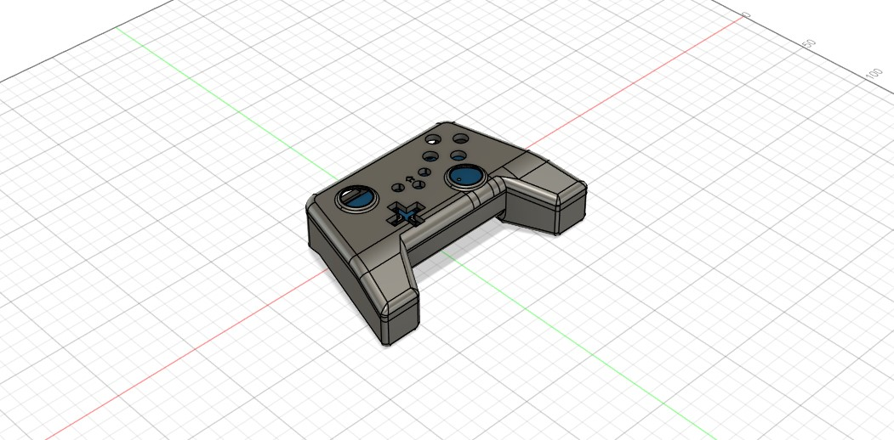

# PC-Video-game-Controller-


# Custom ESP32-S3 Gaming Controller

A custom-designed PC gaming controller featuring a custom PCB, wireless connectivity, motion sensing, and a rechargeable battery system.

## Overview



This project focuses on the design and development of a custom PC gaming controller built around the ESP32-S3 microcontroller.

The controller is designed to combine traditional gamepad functionality with additional hardware capabilities, including gyroscopic motion sensing, Bluetooth connectivity, and USB-C wired operation.

The project currently focuses on hardware development, including circuit design, PCB layout, and mechanical CAD modeling.

## Design Goals

- Develop a custom-designed controller PCB.
- Implement traditional gamepad controls, including analog sticks and physical buttons.
- Integrate gyroscopic motion sensing.
- Support Bluetooth wireless connectivity.
- Support USB-C wired connectivity.
- Incorporate a rechargeable battery system.
- Develop a custom physical enclosure.

## Hardware Features

| Component | Function |
|---|---|
| ESP32-S3 | Main microcontroller |
| ICM-20948 | 9-axis motion tracking sensor |
| BQ24074RGTT | Battery charging and power management |
| Analog Sticks | Analog directional input |
| Physical Buttons | Standard gamepad input |
| USB-C | Wired connectivity |
| Bluetooth | Wireless connectivity |
| Rechargeable Battery | Portable power |

### Component Selection

**ESP32-S3 – Main Microcontroller**

Selected for its ease of hardware integration, available GPIO and peripheral interfaces, and built-in wireless and USB capabilities. Its Bluetooth LE support and native USB functionality make it a convenient choice for a controller designed to support both wireless and wired PC connectivity.

**ICM-20948 – Motion Sensor**

A 9-axis motion tracking sensor combining a gyroscope, accelerometer, and magnetometer. It was selected to provide motion-sensing capabilities in a single integrated component, simplifying the overall circuit design.

**BQ24074RGTT – Battery Management**

A single-cell lithium-ion battery charger with integrated power-path management. It was selected to simplify the rechargeable battery implementation by combining charging and power management functionality into one IC.

## Hardware Design

The controller's electronic circuitry and PCB layout were designed using KiCad.

The hardware design files include:

- Circuit schematics
- PCB layout
- Component footprints
- Supporting hardware design files

## Mechanical Design

The physical design of the controller is developed using CAD software.

The CAD directory contains the 3D models and mechanical design files associated with the controller enclosure and components.

## Technologies & Tools

- **Microcontroller:** ESP32-S3
- **Motion Sensor:** ICM-20948
- **Battery Management:** BQ24074RGTT
- **PCB Design:** KiCad
- **Mechanical Design:** CAD software
- **Connectivity:** Bluetooth LE and USB
- **Programming:** Embedded C/C++ (planned)

## Repository Structure

```text
custom-game-controller/
│
├── hardware/
│   ├── kicad/
│   └── datasheets/
│
├── cad/
│   ├── source/
│   └── exports/
│
├── images/
│
├── docs/
│
├── README.md
└── LICENSE
```

## Current Project Status

**PCB Design — In Progress**

The electronic design and PCB layout have been developed. The project has not yet reached the PCB manufacturing and physical assembly stage.

## Future Improvements

- Manufacture the custom PCB.
- Assemble and integrate electronic components.
- Develop controller firmware.
- Implement analog stick and button input processing.
- Integrate gyroscope input.
- Implement Bluetooth and USB communication.
- Test controller compatibility with PC games.
- Refine the mechanical enclosure and ergonomics.

## License

License information to be determined.
